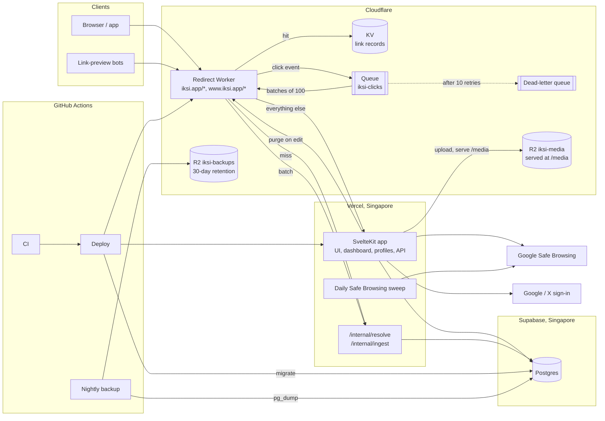
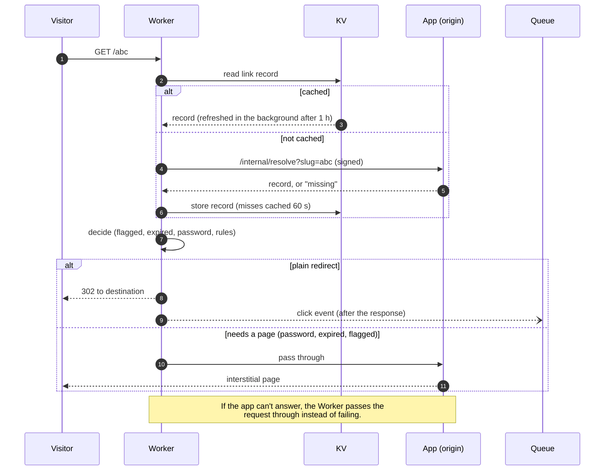
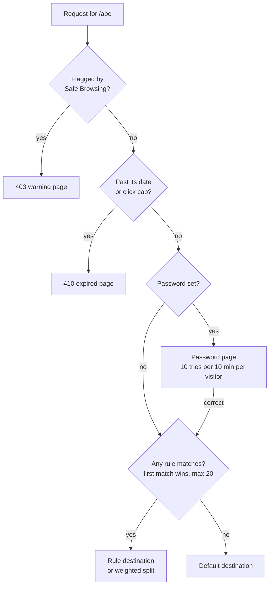
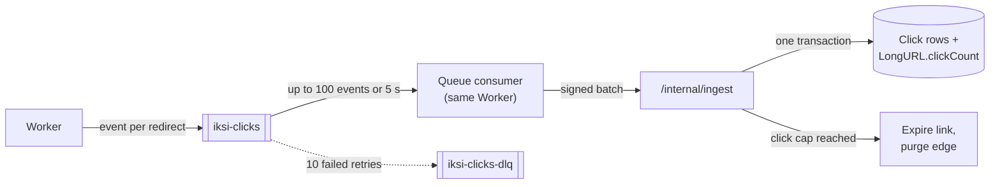
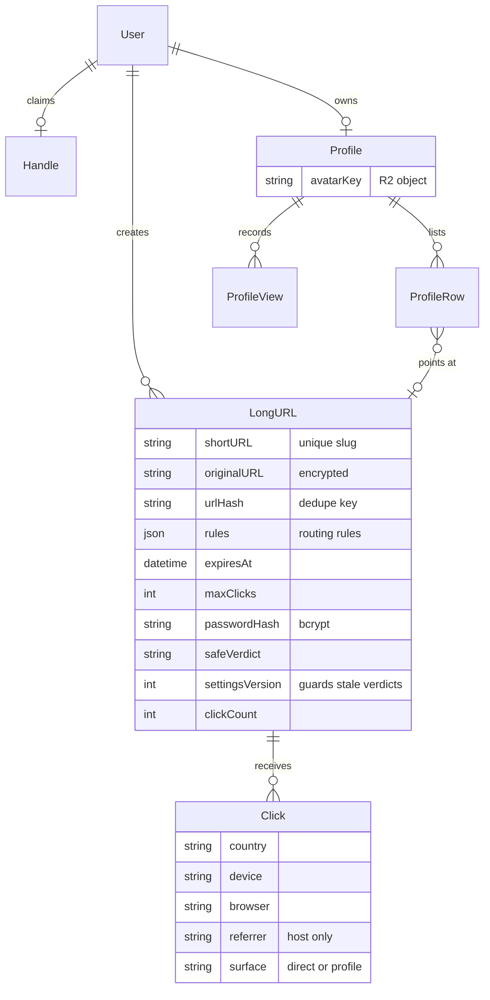
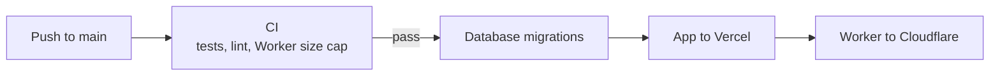

# iksi

A URL shortener with link-in-bio profiles, at [iksi.app](https://www.iksi.app). *Iksi* is Filipino for "short".

Short links resolve at the edge, close to whoever clicks them. Everything else (the dashboard, profiles, auth, the API and background jobs) runs as one regional app next to the database. Redirects are the only latency-critical, read-heavy path, so they are the only part that needs to be everywhere.

- **Short links** with custom aliases, a preview page (`/abc+`) and public stats (`/abc+stats`)
- **Smart routing**: send visitors to different destinations by country, continent, device, OS, referrer or time of day, or split traffic for A/B tests
- **Expiry** by date or by click count, and **password-protected** links
- **Profiles** at `/@handle`: a link-in-bio page whose rows are short links, with uploaded avatars
- **Safety**: every destination, rule targets included, is checked against Google Safe Browsing, and flagged links stop redirecting
- **Privacy**: destinations are encrypted at rest (AES-256-GCM); clicks store country, device and referrer host, never IP addresses

## Architecture

> **Production status:** the edge layer below is built and deployed but switched off. Converge, the largest Philippine ISP, can't reach the site through Cloudflare, so Vercel serves pages and short links directly. See [infra/cloudflare](infra/cloudflare/README.md#edge-on-and-off).



### Redirect path

The Worker answers a redirect on its own whenever it can. On a miss it asks the app once, caches the answer, and never blocks the visitor on click recording.



### How a link decides where to go

The edge and the app run the same engine from `packages/core`, so a link behaves the same no matter which layer answers.



Rules match on country, continent, device, OS, referrer host and time windows in any IANA time zone, daylight saving included. Visitors with no referrer, user agent or country fall through to the default destination.

### Click pipeline



### Data model



### Deploys

Production deploys only from GitHub Actions, in an order where each step only depends on the steps before it.



- **Migrations go first**, so new app code never reads a column that doesn't exist yet.
- **The Worker goes last**, so it never reads a record field the app doesn't serve yet. Link records carry a version number. A Worker that doesn't recognize a record passes the request to the app instead of guessing.
- **Backups** run nightly at 03:00 Singapore time to R2. Every Sunday a restore check loads the latest dump into a scratch database.

## Design decisions

| Decision | Why | Trade-off |
|---|---|---|
| Only redirects run at the edge | It's the one hot, read-mostly path | The dashboard and profiles stay single-region |
| KV cache with app fallback | The edge never needs the database to be up | Edits take up to 60 s to reach every location, though they purge immediately |
| Clicks go through a queue | A slow database never delays a redirect | Click counts lag by a few seconds |
| One routing engine for both layers | Edge and app can't disagree about a link | The engine must stay dependency-free to fit the Worker size cap |
| Destinations encrypted at rest | A leaked database doesn't leak where links go | Dedupe and search need a separate hash |
| Pages render at the app, not the edge | Passwords, warnings and expiry pages reuse the app's UI | Those visits pay the round trip to Singapore |

## Repository

| Path | What it is |
|---|---|
| `apps/web` | SvelteKit app: shortener, dashboard, `@handle` profiles, auth, API, internal endpoints |
| `apps/redirect` | Cloudflare Worker: redirects, KV cache, click queue producer and consumer |
| `packages/core` | Shared, dependency-free TypeScript: path rules, link records, the routing engine |
| `infra/cloudflare` | Deploy and cutover runbooks, R2 media notes |
| `infra/backup` | `pg_dump` to R2 and the restore check |
| `perf` | Load-test scripts and recorded latency reports |

## Running it locally

Needs Node 22 (see `.nvmrc`), pnpm 10 and a Postgres database.

```sh
pnpm install
cp apps/web/.env.example apps/web/.env      # point DATABASE_URL at a local database
pnpm --filter @iksi/web exec prisma migrate deploy

pnpm --filter @iksi/web dev        # app on http://localhost:5173
pnpm --filter @iksi/redirect dev   # Worker via wrangler dev
pnpm -r test                       # every package's tests
pnpm -r build
```

## API

```http
POST /api/shorten
Content-Type: application/json

{ "longURL": "example.com", "customURL": "my-link" }
```

Returns `{ "shortURL": "my-link" }`. Errors come back as `{ "error": "..." }` with `400` for invalid input, `409` for a taken alias and `429` when rate limited (20 requests per minute per IP).

## License

MIT. See [LICENSE](LICENSE).
